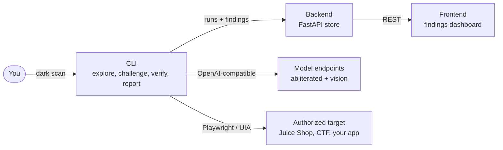

# dark-cli

An AI red-teaming CLI that finds — and proves — security bugs in software you're authorized to test. Abliterated models power the attack side where mainstream models add refusal friction to legitimate security work.

## What it does

```
dark scan http://localhost:3000 --goal "Test the archive workflow"
```

1. **Explore** — map the target's workflows and expected behavior
2. **Challenge** — probe edge cases: empty states, malformed inputs, auth boundaries
3. **Verify** — replay suspected failures in fresh state from a recorded action log (no model in the loop)
4. **Report** — reproduction steps, evidence, and a runnable regression test

A finding only counts once it reproduces.

## Layout

| Folder | Stack | Purpose |
|---|---|---|
| `cli/` | Python + Typer | The `dark` command: scan, ctf, report |
| `backend/` | FastAPI | Stores runs, findings, refusal telemetry; serves the dashboard |
| `frontend/` | Next.js + React + TypeScript | Achilles landing-page recreation |



## Principles

- **Verified findings only.** Replay from a recorded action log in freshly reset state. Screenshots suggest; replay proves.
- **Abliteration measured, not assumed.** Base vs abliterated on confirmed findings, false positives, refusals hit, cost — every run emits telemetry.
- **Authorized targets only.** Own apps, lab environments, sanctioned CTFs, in-scope bug-bounty programs. Anything else is out of scope, full stop.

## Quickstart

```bash
# CLI
cd cli && pip install -e . && dark --help

# Backend
cd backend && pip install -e . && uvicorn app.main:app --reload

# Frontend
cd frontend && npm install && npm run dev   # http://127.0.0.1:3000
```

Model endpoints are configured via `.env` (see `.env.example`).

## Native Windows milestone

The desktop slice runs independently of the backend/dashboard. It uses the
[Windows MCP server](https://github.com/sbroenne/mcp-windows) over stdio, with its
native executable resolved by absolute path. The local setup pins release
`v1.3.28` and verifies the download's SHA-256. The binary stays in ignored
`.tools/`; no system installation or .NET SDK is required for the server.

From the repository root, in PowerShell:

```powershell
uv venv .venv
uv pip install --python .venv\Scripts\python.exe -e './cli[dev]'
.\scripts\setup-desktop.ps1
.\.venv\Scripts\dark.exe desktop doctor
.\.venv\Scripts\dark.exe desktop windows
```

`doctor` performs a real MCP handshake and checks required tools. To inspect an
application, use its exact, unique window title from `desktop windows`:

```powershell
.\.venv\Scripts\dark.exe desktop probe --title 'My App' --screenshot
.\.venv\Scripts\dark.exe desktop probe --title 'My App' --expect 'Ready'
```

Probes do not click or type. `--expect` checks displayed control labels and values,
excluding protocol metadata. The PNG, snapshot, append-only event log and report stay
under `.dark/runs/`. Reports distinguish observation, passed checks, failed
checks, and infrastructure errors. A passed check is not a verified vulnerability.

### Disposable native demo

The included WinForms fixture deliberately accepts negative inventory quantities.
It does not access other apps, accounts, or external services. Its build script
uses the Windows .NET Framework compiler, then opens a visible test window.

```powershell
.\scripts\start-desktop-fixture.ps1
.\.venv\Scripts\dark.exe desktop probe --title 'Dark Desktop Fixture' --expect Ready --screenshot

# Without --apply, validate and preview only.
.\.venv\Scripts\dark.exe desktop exercise examples\desktop\positive.json
.\.venv\Scripts\dark.exe desktop exercise examples\desktop\positive.json --apply

# Expected failure: the fixture saves -2 instead of rejecting it. Exit code 1.
.\.venv\Scripts\dark.exe desktop exercise examples\desktop\negative.json --apply
```

Exercises contain explicit `click`, `type`, and `assert_text` steps. Assertions
compare the selected control's text exactly (ignoring case) by default; set `"match": "contains"`
for a substring check. Each operation rediscovers a unique element using its
automation ID or exact name. Opaque session element IDs are never stored as
replay selectors. Scenarios must end with an assertion, and a failed assertion
stops the exercise. Mutations are not
automatically retried after timeouts, because their outcome may be unknown.

The example scenarios reset the fixture and assert `Ready` before proceeding.
For another app, a new run does not reset its data: define and verify its reset
procedure before treating repeated failures as reproducible findings. A saved
run's `scenario.json` can be supplied to `desktop exercise` to repeat it.

### Optional Jev decision preview

Set `TYPESAFE_API_KEY` in `.env`, then:

```powershell
.\.venv\Scripts\dark.exe desktop decide --title 'Dark Desktop Fixture' --goal 'Inspect the inventory controls'
```

This sends the selected window's accessibility snapshot and goal to TypeSafe.
Jev chooses among four bounded next-step categories; its answer is recorded but
never executed. No model key is needed for probes or explicit exercises. Jev's
HTTP contract is covered with mocked responses; live Jev behavior still needs
evaluation with a configured key. Keep target content and local evidence private.

The natural-language exploratory `dark scan` pipeline and CTF mode remain
scaffolds. The next milestone is model-guided control selection on this tested
adapter, followed by fresh-state replay and finding export. Excel, PowerPoint,
and arbitrary-app reliability are not yet implemented or validated here.

### Verification

```powershell
.\.venv\Scripts\python.exe -m pytest cli\tests -q
.\.venv\Scripts\python.exe -m ruff check cli

# With the disposable fixture open: tests only that app, without model calls.
.\.venv\Scripts\python.exe scripts\smoke-desktop.py
```

Tests cover ambiguous targets, protocol/tool failures, mutation timeouts, exact
assertions, preview mode, released-server element IDs, and Jev response validation.

## Roadmap

Weekend plan: [docs/PLAN.md](docs/PLAN.md).
